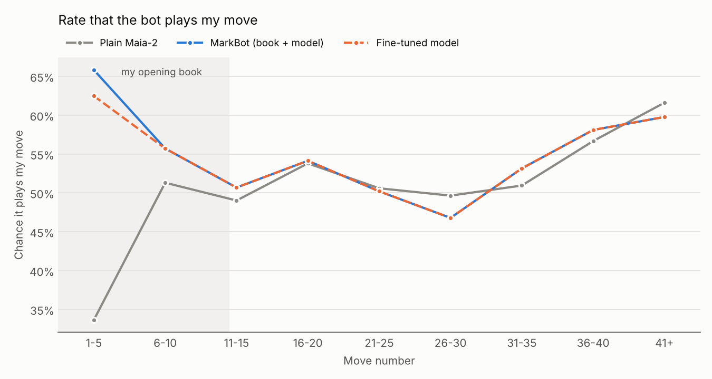

# MarkBot

A chess bot that plays like me (GMMark12 on chess.com, around 1800 rapid) instead of like a perfect engine.
The idea is that my friends can play it on Lichess and it feels like playing me, with my openings, my habits
and my mistakes.

## Plan
I download all my chess.com games, build an opening book from what I actually play, and then take
[Maia-2](https://github.com/CSSLab/maia2), a model that already predicts the moves real people make at each
rating, and train it further on my own moves. That gets wrapped up as a UCI engine that plays at 1800 in any
chess app or on Lichess. To check it really plays like me, I keep my most recent games out of training and see
how often the bot picks the move I actually played.

## Progress
- [x] Day 1, project setup and game fetcher
- [x] Day 2, training data prep with recency and time control weighting
- [x] Day 3, fine-tuning script and first training run
- [x] Day 4, opening book builder
- [x] Day 5, UCI engine and ONNX export
- [x] Day 6, held-out evaluation
- [x] Day 7, Windows setup scripts
- [x] Day 8, lichess-bot config and launcher
- [x] Day 9, server setup script and systemd service
- [x] Day 10, bot live on Lichess around the clock
- [x] Day 11, experiment with rapid-only vs all games
- [x] Day 12, set the opponent rating from the real Lichess opponent
- [x] Day 13, automatic monthly retraining on new games
- [x] Day 14, accuracy by move number chart and write-up

## Quick start
```
pip install -r training/requirements.txt
pip install --no-deps maia2==0.10.0
python training/fetch_games.py GMMark12   # every game -> data/games.pgn
python training/prep_data.py GMMark12     # training examples -> data/dataset.pt
python training/finetune.py               # fine-tuned model -> models/mark_model.pt
python training/build_book.py GMMark12    # opening book -> models/book.json
python training/export_onnx.py            # lightweight model -> models/mark_model.onnx
python training/evaluate.py GMMark12      # how well it matches me -> results/eval_results.json
```
On Windows I don't have to do all of that. `windows\setup.bat` makes a `.venv` and installs everything once,
and `windows\retrain.bat` runs all six steps in order and stops if one fails, so retraining on my newest games
is just about 45 minutes of waiting. It builds the bot's opening book from every game (`--holdout 0`) while the
evaluation builds its own book without the test games, so the results stay fair. Each retrain overwrites
`results/train_log.txt` and `results/eval_results.json` with the new run.

## How it works
`prep_data.py` turns every position where I was to move into a training example. Recent games and rapid games
count more, and moves I made with under 10 seconds left get dropped since those are mostly panic moves. My 150
most recent games are kept aside as a test set and never get trained on.

`finetune.py` takes Maia-2's rapid model, which already plays like a typical human at each rating, and keeps
training it on my games so it drifts toward playing like me. Moves from recent and rapid games pull harder than
moves from old blitz games. To keep training honest I also hold back the 100 games right before the test set.
Every 250 steps the script checks how often the model would have picked my real move in those games, and it
only saves the model when that beats its previous best. A full run (two passes over the data) takes about 40
minutes on a regular CPU, and it uses a GPU automatically if PyTorch finds one. The log from my first run is
in `results/train_log.txt`.

`build_book.py` records what I actually play in the first 12 moves of my games, so the bot opens the way I do
instead of guessing. If I've reached a position in at least 3 games, the bot picks from the moves I played
there at least twice, about as often as I played each one, with recent games counting more. Once a game leaves
my usual lines the neural net takes over. By default the book skips my 150 most recent games so it doesn't
peek at the test set, and the version the bot actually plays with is built from every game with `--holdout 0`.

## Playing against it
`engine/markbot.py` is the bot itself. It's in UCI, the language chess programs use to talk to engines, so it
works in any chess app and with lichess-bot. On its turn it checks my opening book first, and if the position
isn't there it asks the model which moves I'd likely play at 1800 and picks one based on those chances. It
doesn't calculate ahead like Stockfish. It just plays the move I would, blunders included.

The engine runs on ONNX instead of PyTorch, so it only needs three small packages and picks a move in a few
milliseconds. It needs `mark_model.onnx`, `moves.json` and `book.json` in the `models/` folder.

Some chess apps, like En Croissant on Windows, only load `.exe` engines, so `engine/build_exe.bat` packs the bot
into a single `engine/markbot.exe` with PyInstaller. Double-click the script and add `engine/markbot.exe` as a
UCI engine in the app. It still reads the model files from `models/`, so keep the `.exe` in the `engine/` folder.
Apps that can run a Python script directly, like Cute Chess, can use it without building anything.
```
pip install -r engine/requirements.txt
python engine/markbot.py
```
In the app's engine settings you can change its rating, turn the opening book off, or turn down the randomness
so it always plays my single most likely move.

## On Lichess
MarkBot is online on Lichess all the time as [MarkBot12](https://lichess.org/@/MarkBot12), so you can play it
whenever by going to its profile and clicking Challenge. It only plays real people, one game at a time, in
bullet, blitz, rapid or classical, and the games can be casual or rated. It never resigns or offers a draw since
it has no idea when a game is lost, so every game gets played out to the end. At the start of every game
lichess-bot tells it who it's playing, and it uses that person's real Lichess rating, so it plays a 1400
differently than a 2100 just like I would. If you want to run it yourself,
`windows\lichess_bot.bat` downloads [lichess-bot](https://github.com/lichess-bot-devs/lichess-bot), sets up its
config from `deploy/lichess-bot-config.yml` and puts the bot online. You'll need a brand new Lichess account
for the bot and a token for it.

## Running it on a server
My PC can't stay on all day, so the bot runs on a small free Linux server from Google instead. My model files
aren't on GitHub, so they get copied over from my PC by hand. After that `deploy/setup_server.sh` installs
everything, asks for the bot's token once and sets MarkBot up as a systemd service, which starts the bot
whenever the server boots and restarts it if it crashes.
```
git clone https://github.com/Lunaris12/MarkBot.git && mkdir -p MarkBot/models     # on the server
scp models/mark_model.onnx models/moves.json models/book.json USER@SERVER_IP:MarkBot/models/   # on my PC
bash MarkBot/deploy/setup_server.sh                                                # on the server
```
`sudo systemctl status markbot` shows if it's running and `journalctl -u markbot -f` shows its live log. When
I change the code, I push it to GitHub and run `bash MarkBot/deploy/update_server.sh` on the server, which pulls
the new version and restarts the bot. If I retrain, I copy the new model files over the same way and run the
same script.

## How well it plays like me
`training/evaluate.py` tests the bot on my 150 most recent games, which it never trained on. For every position
where it was my turn, it checks whether the bot's top choice is the move I actually played, and compares that
with plain Maia-2, the model I started from. The opening book it uses for this is built without those games too.

| | All moves | First 12 moves | After move 12 |
|---|---|---|---|
| Plain Maia-2 | 49.4% | 43.4% | 53.1% |
| My fine-tuned model | 54.8% | 57.5% | 53.1% |
| MarkBot (book + model) | 55.3% | 59.0% | 53.1% |

That's 4,615 positions from games played between February 2024 and October 2026, and the first 12 moves are the
same stretch my opening book covers. All of the gain is in the opening, where I tend to play the same moves, so
the bot goes from guessing my move 43% of the time to 59%. After move 12 it does no better than plain Maia-2, so
my middlegame and endgame moves look a lot like any other 1800 player's, at least as far as 2,000 games can
show. Nobody plays the same move in the same spot every time, so 100% isn't possible.

## Where it plays like me
The first 12 moves vs everything after split hides a lot, so `training/accuracy_by_move.py` breaks the same
150 test games into groups of 5 moves and checks each one separately.



Almost all of the difference is in the first 10 moves. Plain Maia-2 only guesses my first 5 moves 34% of the
time, since it has no idea what openings I play, while MarkBot gets 66% of them. My fine-tuned model gets most
of that on its own (63%) and the opening book adds the last few points. By moves 6 to 10 the book stops
mattering, since the model has learned my lines well enough to pick the same moves, and the gap to plain
Maia-2 shrinks to about 4 points. After that the lines basically sit on top of each other. Moves 26 to 30 are
the only spot where MarkBot does noticeably worse than plain Maia-2 (47% vs 50%), which is probably just noise
from a few hundred positions. Everyone gets better again late in the game, around 60% past move 40, because
endgames have fewer sensible moves and a lot of them are forced.

## Monthly retraining
I still play on chess.com, so the bot should keep up with how I play now. On the 1st of every month my PC
runs `training/monthly_retrain.py`, which downloads my games again and stops right away if there's nothing
new. If there is, it trains a new model and opening book off to the side in `models/candidate`, then tests
both the new model and the current one on my 150 most recent games. The new one only replaces the current
one if it matches my moves at least as often, and the old one gets kept in `models/previous` just in case.
Every run adds a line to `results/retrain_history.txt` saying what happened.

Training is way too heavy for the free server, so it runs on my PC and then sends the new files to the
server itself with Google's `gcloud` tool. To set that up I installed the
[Google Cloud CLI](https://cloud.google.com/sdk/docs/install), ran `gcloud init`, and made
`deploy/server.txt` with one line holding my server login and zone, like
`myname@my-server us-east1-b`. The login is whatever `whoami` prints in the server's
SSH window. That file stays off GitHub. Then running `windows\schedule_retrain.bat` once sets up the
monthly schedule in Windows Task Scheduler and checks that the PC can reach the server. Without
`server.txt` it still retrains every month, and I just copy the files over by hand like before.

## Rapid only vs all games
Most of my games are blitz, but my 1800 is a rapid rating, so I wanted to know if a bot
trained on only my rapid games would copy me better than one trained on everything. `finetune.py --only rapid`
trains on just my rapid games, which is only 2,614 positions compared to 57,634 for the full model. I tried it
once with the same settings as my main model and once with 10 passes over the data instead of 2 to make up for
having so much less. All three were tested on the same 150 games with the same opening book.
```
python training/finetune.py --only rapid --epochs 10 --eval-every 50 --out models/rapid_only_10.pt --log results/train_log_rapid_only_10.txt
python training/export_onnx.py --model models/rapid_only_10.pt --out models/rapid_only_10.onnx
python training/evaluate.py GMMark12 --model models/rapid_only_10.onnx --out results/eval_rapid_only_10.json
```

| Full bot (book + model) | All moves | Rapid games | Blitz games | Bullet games |
|---|---|---|---|---|
| Plain Maia-2, no book | 49.4% | 52.6% | 50.3% | 46.4% |
| Trained on all my games | 55.3% | 57.2% | 57.0% | 52.6% |
| Rapid only, 2 passes | 54.4% | 56.9% | 55.1% | 52.1% |
| Rapid only, 10 passes | 54.8% | 56.6% | 55.5% | 52.8% |

Training on everything still wins, even on my rapid games, where I expected the rapid-only bot to have the edge.
The gaps are small though, around a point, and with only about 1,200 rapid positions in the test set that's
close to the size of random luck. So the honest takeaway is that rapid only isn't better, and since it isn't
better the real bot keeps training on all my games. My guess is that my habits show up in blitz too, so having
20 times more examples matters more than the time control matching. The numbers are in
`results/eval_rapid_only.json` and `results/eval_rapid_only_10.json`, next to the main model's in
`results/eval_results.json`.

## What I learned
The main thing this project taught me is that my chess is more "me" in the opening than anywhere else. The
bot copies my openings really well, but from the middlegame on I play like a pretty typical 1800, and 2,000
games of mostly blitz weren't enough for the model to find anything personal in how I play those positions.
Training on only my rapid games didn't help either, since more data mattered more than matching the time
control. If I keep going with this, the things I'd try next are training on more of the middlegame
specifically, giving the model my clock time so it knows when I'm rushing, and seeing whether the monthly
retraining slowly pulls it closer to how I play now.

## Credits
MarkBot is built on [Maia-2](https://github.com/CSSLab/maia2) (Tang et al., NeurIPS 2024), the human move
model I fine-tuned, and uses [python-chess](https://github.com/niklasf/python-chess) for the chess logic and
[lichess-bot](https://github.com/lichess-bot-devs/lichess-bot) to connect it to Lichess.
